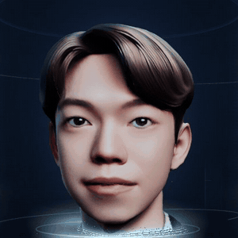
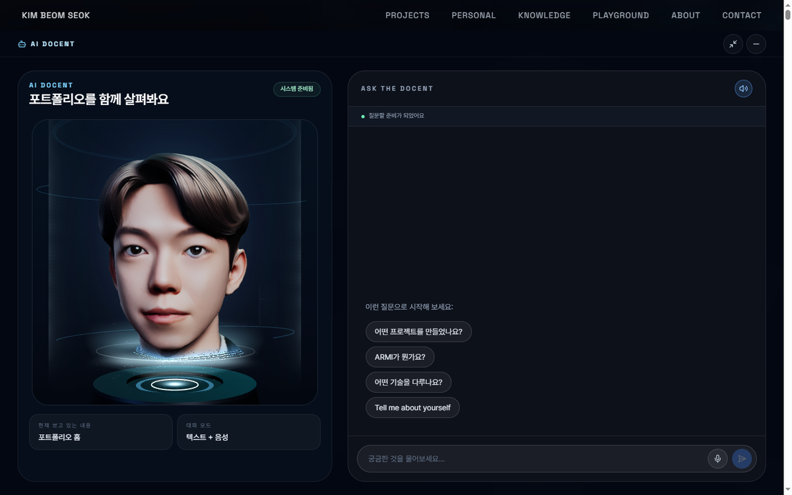
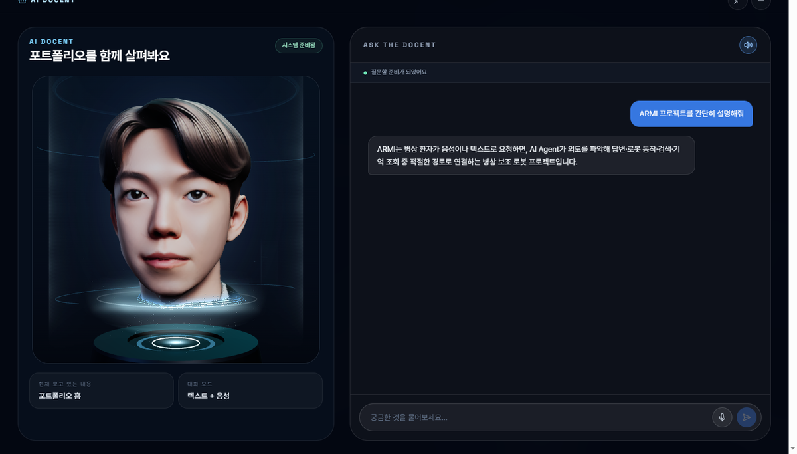
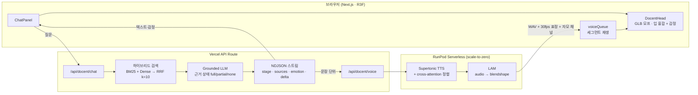
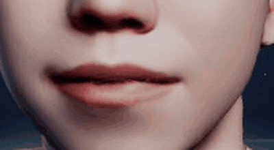
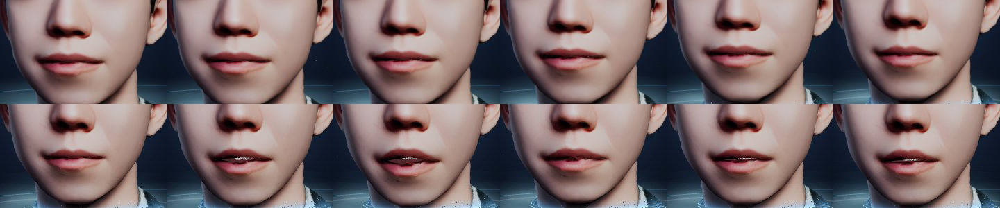
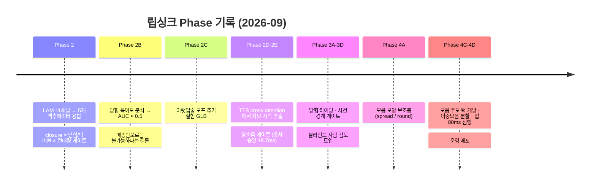
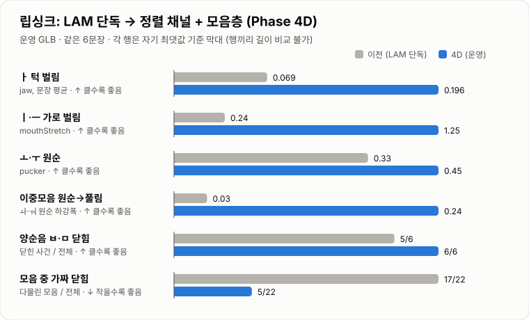
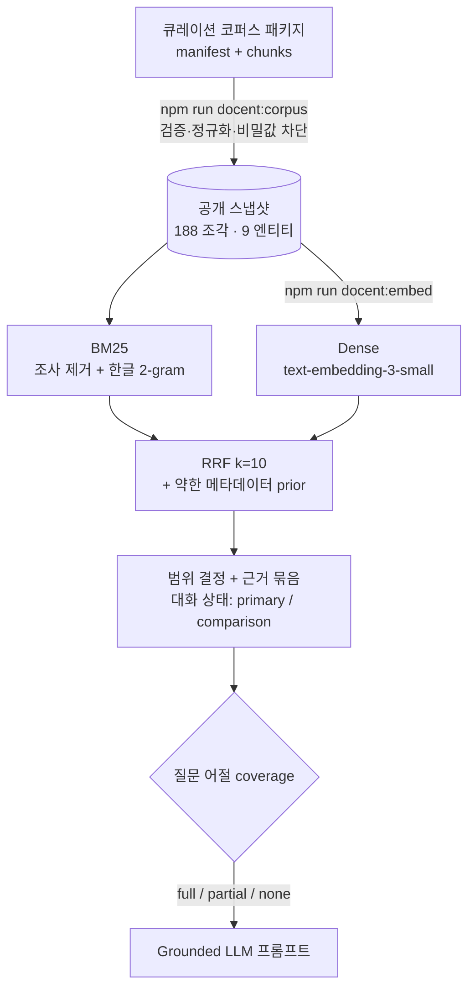
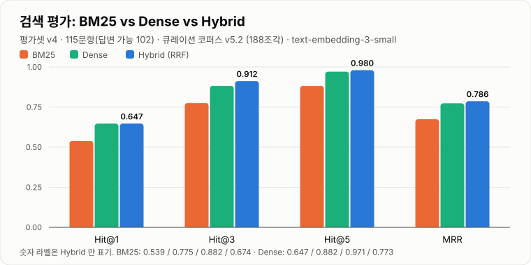

<div align="center">

# Digital Docent (DD)

**사진 한 장으로 만든 3D 홀로그램 도슨트가, 포트폴리오에 대해 말로 답하는 프로젝트**

검증된 코퍼스 기반 하이브리드 RAG · 한국어 TTS · 오디오 기반 표정 · 자모 단위 입모양 정렬

[**Live Demo**](https://beomseok-portfolio.vercel.app) (우측 하단 `AI DOCENT`) · [구현 코드 (beomseok-portfolio)](https://github.com/beomseok-kim0210/beomseok-portfolio/tree/master/src/features/docent)



</div>

---

## 한눈에 보기



| 영역 | 무엇을 하나 | 핵심 |
|---|---|---|
| **아바타** | 사진 → 개인화 3D 헤드 → 홀로그램 챔버 | SOAP/GNM 파이프라인, GLB 모프 계약, React Three Fiber |
| **대화** | 포트폴리오 질문에 근거 기반으로 답변 | BM25 + Dense → RRF, 근거 coverage 판정, 대화 상태 추적 |
| **음성** | 답변을 한국어 음성으로 스트리밍 | Supertonic TTS, ≤140자 세그먼트 큐, RunPod Serverless GPU |
| **얼굴** | 소리에 맞춰 표정·입모양 | LAM 오디오→블렌드셰이프, 자모 정렬 채널, 모음 모양 보조층 |



---

## 아키텍처



- **런타임은 Notion·GitHub 를 직접 검색하지 않는다.** 큐레이션된 코퍼스를 검증·정규화한 스냅샷(188조각)만 읽는다.
- **감정은 텍스트에 섞이지 않는다.** 모델이 붙인 `<emotion>` 태그는 위치·형식·스트림 경계와 무관하게 메타데이터로 분리되어 모프타겟을 구동한다.
- **음성은 재생이 시작된 뒤에만 다음 1개를 미리 합성한다.** 재생 전에 던지면 CPU 경합으로 첫 소리가 5~6초 밀리는 것을 실측으로 확인했다.

---

## 입모양(립싱크) — 어떻게 발전시켰나

> 출발점은 "LAM 이 내놓는 52채널 블렌드셰이프를 그대로 GLB 에 꽂는 것"이었다.
> 결과는 **웅얼거림** — 입이 거의 안 벌어지고, ㅣ/ㅡ 에서 다물리고, ㅂ/ㅁ 이 아닌 곳에서도 닫혔다.

<div align="center">

<br/><sub>운영 사이트에서 headless 로 녹화한 실제 발화 장면</sub>
</div>



### 단계별 기록



#### 1. 융합 매핑 (Phase 2)
LAM 의 jaw · close · funnel · press · roll 채널을 GLB 의 5개 액추에이터로 융합했다.
`close` 절댓값만 쓰면 원순 모음 "오" 에서 입이 다물려서, **닫힘을 턱 대비 비율 × 절대량 게이트**로 정의했다.

#### 2. "매핑으로는 안 된다"는 증명 (Phase 2B)
사전 등록한 38개 사건(양순 11 / 비양순 27)에서 LAM 52채널 + ±2프레임 문맥 특징의 AUC 가 전부 **≈0.5**,
튜닝셋과 홀드아웃에서 방향까지 뒤집혔다. ㅅ·ㅈ·ㄷ 에서 LAM 은 턱을 거의 안 쓰고 아랫입술로만 틈을 만드는데,
GLB 에 대응 모프가 없다 → 매핑을 아무리 바꿔도 "윗입술 들림" 아니면 "웅얼거림" 중 하나.

#### 3. TTS 내부에서 자모 시각을 꺼내기 (Phase 2D–2E)
Supertonic 은 전체 길이만 낸다. 그러나 한글이 NFKD 로 **초성·종성 자모 토큰**이 되고,
vector estimator 의 text cross-attention 에서 각 자모가 몇 ms 에 발음되는지 읽을 수 있다.
같은 합성 한 번에 attention 을 함께 받도록 ONNX 계측 사본을 만들었고, **WAV 바이트 동일성**으로 음질 무변화를 검증했다.

- 양순음(ㅂ·ㅁ·ㅍ) 시각 오차: 홀드아웃 18문장 **중앙 18.7 ms / p90 50.6 ms** (균일 배분 기준선 42.8 / 123 ms)
- 30fps `bilabialGate` 채널 → 양순음에서만 입술을 확실히 닫는다

#### 4. 사람 눈이 보는 것은 모음이었다 (Phase 3D → 4A)
닫힘 FP 같은 대리 지표를 다듬어도 블라인드 검토에선 차이가 거의 안 보였다. 피드백은 한결같았다 —
*"입이 안 벌어진다", "ㅣ/ㅡ 가 가로로 안 벌어진다", "우 모양이 안 된다".*
원인: **ㅣ/ㅡ 에서 LAM 닫힘 비율이 1.0 으로 치솟아 모음 중에 입이 다물리고 있었다.**

→ 같은 정렬에서 모음 자모를 분류(spread / open / round / roundGlide)해 30fps 모음 채널을 만들고,
`stretch = max(LAM, 2.4·spread)`, `round = max(LAM·(1−unround), 0.5·round)`, 모음 중엔 LAM 닫힘을 해제.
블라인드 A/B: **원순 6–0, 자연스러움 4–0** 으로 모음층 승.

#### 5. 벌림의 양과 타이밍 (Phase 4C–4D)
- **모음 주도 턱 개방**: 자모별 개방도 표(ㅏ 1.0 … ㅡ 0.25), 지지 구간 = 앞뒤 자모 중점 사이
- 4C 블라인드 검토: "4A 는 살짝 덜, 4C 는 살짝 많다 — 중간이 최고", "입과 소리가 미세하게 어긋난다"
- 진단: 모음 턱 목표는 소리와 정렬(지연 0)인데 감쇠(λ18) 때문에 렌더가 30~50 ms 늦음
- 4D: 개방 스케일 0.75, **열림 채널 60 ms 선행**, ㅘ·ㅝ·ㅙ·ㅞ 는 앞 40% 원순 → 뒤 모음으로 분할, 전체 **입 80 ms 선행**
- 결과: 입술 간격–음량 xcorr 지연 **+50 → +10 ms**, 턱 정점–음량 정점 **+30 → 0 ms**

#### 6. 운영 반영
운영 음성 경로(Vercel → RunPod)에는 정렬 채널이 없어서, 로컬에서 검증한 4A~4D 가 운영에선 전부 꺼져 있었다.
RunPod 이미지를 계측 ONNX 와 함께 재빌드(이미지 안에서 오디오 동일성 재검증)하고 템플릿만 교체해 배포했다.



운영 실측(22세그먼트): 양순음 닫힘 **106/106**, 모음 중 가짜 닫힘 24/224, 콜드 18.6 s · 웜 2.8 s.

---

## 대화 — 하이브리드 RAG



- **의도 분류 정규식을 걷어냈다.** 검색은 근거를 찾고, 답변 깊이는 모델이 대화를 보고 정한다.
- **근거 판정은 최종 근거 기준 coverage.** "혈액형이 뭐야?" 같은 질문은 `partial` 로 표시해 모르는 부분을 밝히게 한다.
- **대화 상태 추적.** "BCOS 가 뭐야?" → "Claw Dev 랑 뭐가 달라?" → "실제로 검증했어?" 에서 주제(BCOS)를 잃지 않는다.
- **임베딩 실패 시 같은 경로가 BM25 만으로 동작** (`hybrid_mode=bm25_fallback`), 아티팩트는 corpus 해시로 stale 감지.
- **공개 스냅샷 출처 최소화.** 원 출처는 sha256 기반 불투명 키로만 남기고, 비공개 이름이 남은 스냅샷은 빌드·런타임 게이트가 거부한다.



| 검색 | Hit@1 | Hit@3 | Hit@5 | MRR |
|---|---|---|---|---|
| BM25 | 0.539 | 0.775 | 0.882 | 0.674 |
| Dense | 0.647 | 0.882 | 0.971 | 0.773 |
| **Hybrid (RRF)** | **0.647** | **0.912** | **0.980** | **0.786** |

<sub>평가셋 v4 115문항(답변 가능 102), 코퍼스 v5.2. 공개 범위 밖 이름을 묻는 노출 검사 질문은 별도 로컬 셋으로 분리.</sub>

---

## 음성 파이프라인

| 문제 | 해결 |
|---|---|
| 긴 답변이 413 → 브라우저 TTS(다른 목소리)로 새어 나감 | 브라우저 TTS 폴백 제거, 답변을 ≤140자 세그먼트로 분할 |
| 첫 소리까지 너무 김 | 텍스트 스트림을 문장 단위로 끊어 바로 합성 (웜 첫 재생 17.1 s → ~11 s) |
| 미리 합성하면 오히려 늦어짐 | 재생 시작 후에만 다음 1개 선합성 |
| 콜드 GPU 워커 | idle 90 s 후 재워밍, "음성 엔진 준비 중" 상태 표시 |
| LAM 전처리 콜드 15.8 s | 요청 경로에서 librosa 제거 (출력 비트 동일 11/11) |

---

## 이 저장소에 있는 것

이 저장소는 DD 를 포트폴리오 저장소에서 분리하기 위한 **독립 베이스라인**입니다.
현재 실제 웹 구현(도슨트 UI · RAG · 립싱크 융합 · RunPod 워커)은
[`beomseok-portfolio`](https://github.com/beomseok-kim0210/beomseok-portfolio) 저장소에 있고, 이 저장소에는 다음이 있습니다.

```
.github/workflows/   dd-soap-image*.yml   SOAP 이미지 빌드·증거 수집 (workflow_dispatch 전용)
docker/                                    사진 → 3D 헤드(SOAP) 환경의 결정론적 lock set
  Dockerfile.v2 / Dockerfile.final         후보 이미지 → lock set 만으로 재구성하는 최종 이미지
  build_final_lock.py · verify_lock_coverage.py · validate_runtime.py
tests/                                     node:test 스캐폴드
AGENTS.md                                  엔지니어링 규칙 (DOM-free core, Windows-first, 증거 원칙)
```

운영 아바타(`qka2`)를 만든 SOAP 환경을 GPU 없이 CPU 빌더에서 재현 가능한 이미지로 고정하는 것이 이 저장소의 첫 마일스톤입니다.

### 포트폴리오 저장소의 주요 파일

| 파일 | 역할 |
|---|---|
| `src/features/docent/DocentHead.tsx` | GLB 모프 구동, 감정·입 블렌딩 |
| `src/lib/docent/lamMouthFusion.ts` | LAM 채널 → 액추에이터 융합 |
| `src/lib/docent/bilabialGate.ts` | 자모 정렬 → 30fps 양순음 게이트 |
| `src/lib/docent/vowelShape.ts` | 모음 모양·개방 채널, 이중모음 분할 |
| `src/lib/docent/closureTiming.ts` | 닫힘 전용 감쇠·선행 타이밍 |
| `src/lib/docent/rag/` | BM25 · Dense · RRF · 대화 상태 |
| `voice/supertonic_align.py` | 같은 합성에서 cross-attention 정렬 |
| `runpod/` | Serverless 이미지 · 핸들러 · 측정 기록 |

---

## 기술 스택

`Next.js 15` `React 19` `Three.js` `React Three Fiber` `TypeScript` · `OpenAI (LLM · text-embedding-3-small)` · `Supertonic TTS (ONNX)` `LAM` · `RunPod Serverless` `Docker` `GitHub Actions` · `Vercel`

## 개발 원칙

- **사람 눈이 기준이다.** 립싱크 개선은 대리 지표가 아니라 짧은 블라인드 검토(정답표는 검토 후 개봉)로 확정했다.
- **증거 없이 "통과"라고 말하지 않는다.** 모든 단계는 측정값·실행 출력과 함께 기록했다.
- **순수 함수 코어.** 알고리즘은 typed array 를 받고 돌려주며, Canvas·WebGL·React 는 얇은 어댑터에만 둔다 — `node --test` 로 브라우저 없이 검증.
